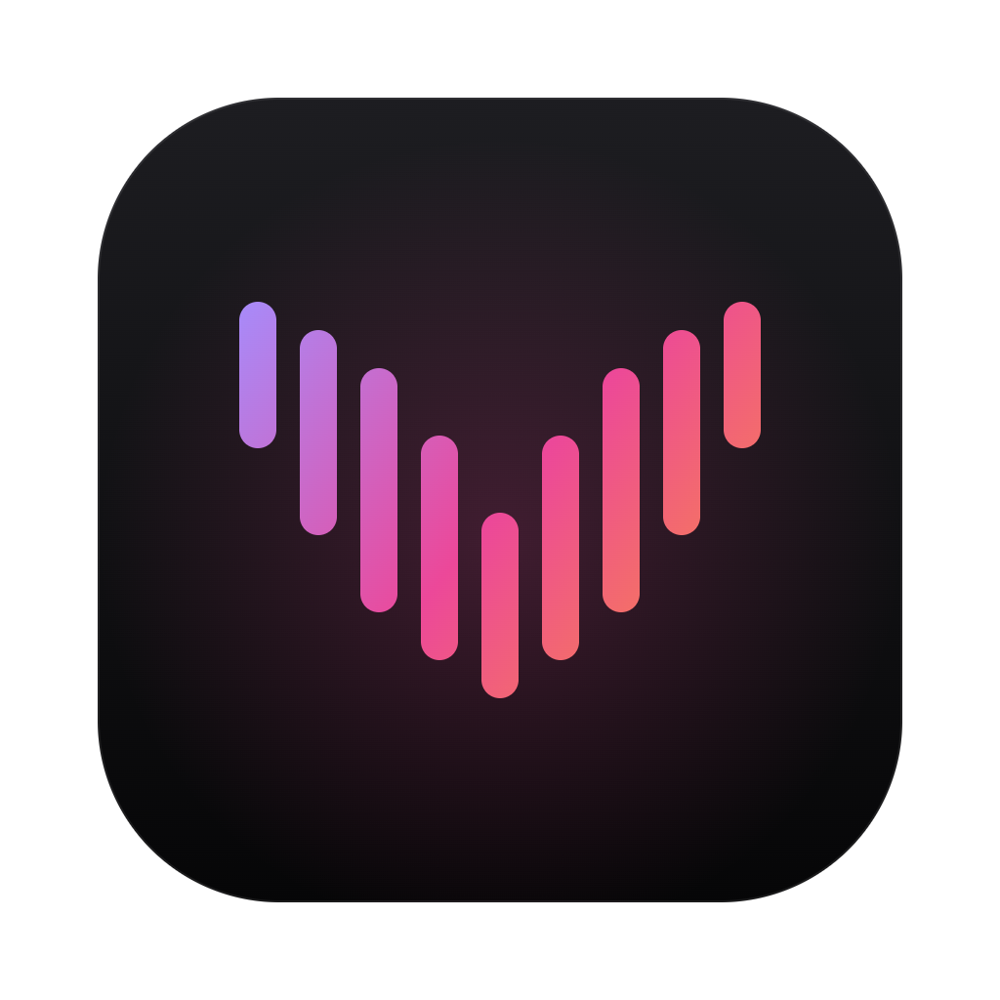
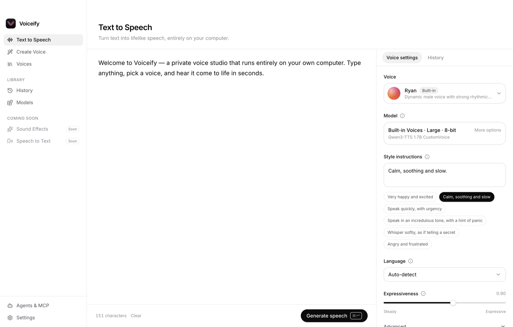
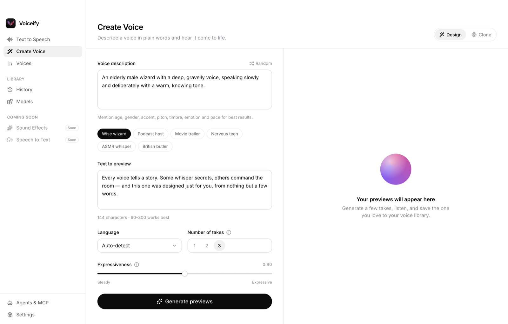
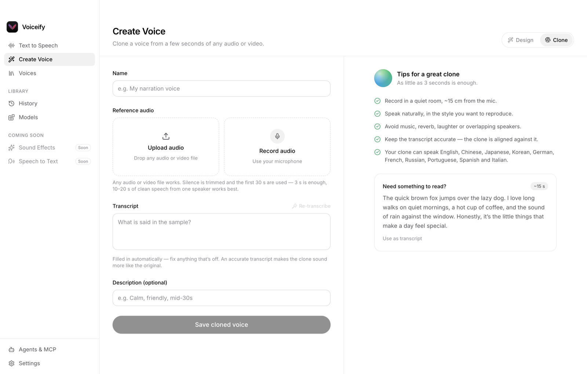
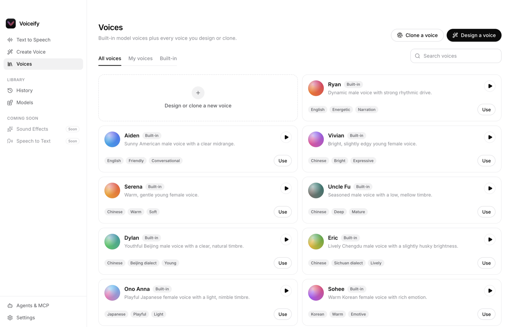
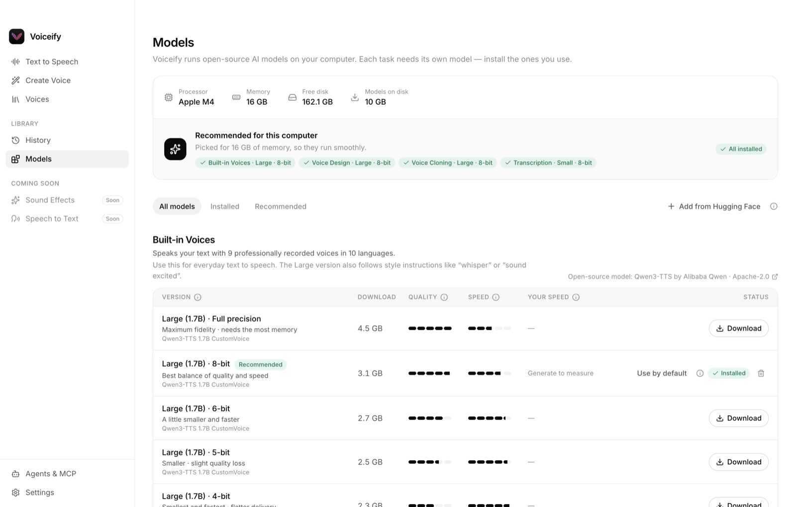
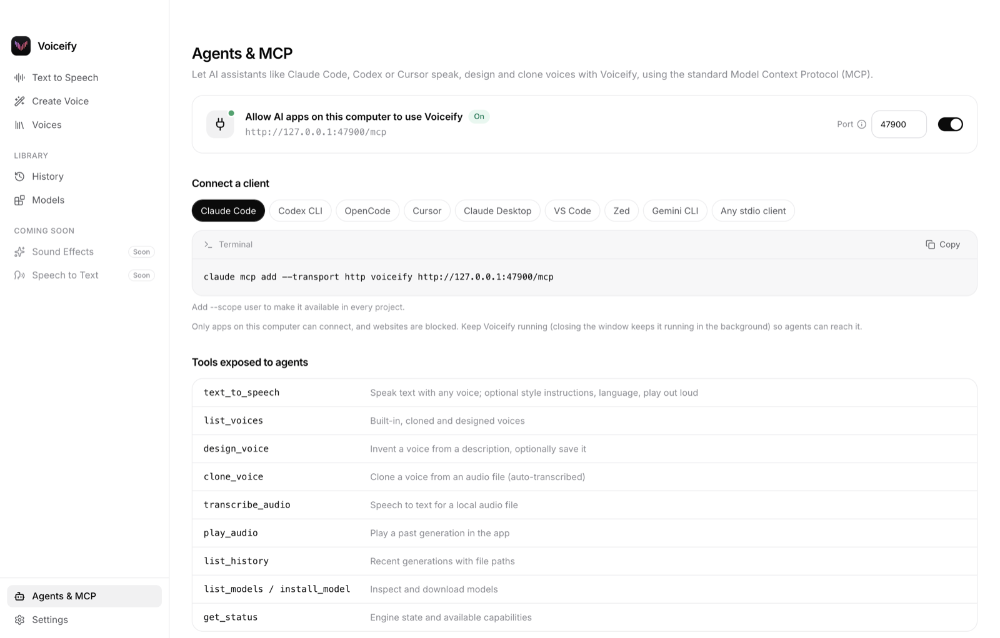
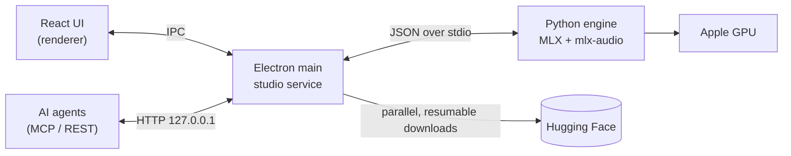

<div align="center">



# Voiceify

**A private voice studio that runs on your own computer.**<br>
Text to speech, voice design and voice cloning with multiple open-source AI models. No cloud, no accounts, no per-character fees.

[](LICENSE)
[-black?logo=apple)](#requirements)
[](https://github.com/iam-kanav/Voiceify/releases)
[](https://github.com/iam-kanav/Voiceify/actions/workflows/ci.yml)
[](#connect-ai-agents-mcp)

[**Download**](https://github.com/iam-kanav/Voiceify/releases/latest) · [Features](#features) · [Install](#install) · [Models](#models) · [AI agents](#connect-ai-agents-mcp) · [Contributing](CONTRIBUTING.md)

<br>

<picture>
  <source media="(prefers-color-scheme: dark)" srcset="docs/images/tts-dark.png">
  
</picture>

</div>

## Why Voiceify?

- **Private by design.** Your text, recordings and voices never leave your computer. After setup, everything works offline.
- **Free to run.** No subscriptions or character quotas. Generate as much audio as your hardware allows.
- **Several open models, one studio.** [Qwen3-TTS](https://huggingface.co/collections/Qwen/qwen3-tts) for expressive speech in 10 languages, voice design and high-fidelity cloning; [Pocket TTS](https://huggingface.co/kyutai/pocket-tts) for tiny (140 MB), very fast English voices and cloning. Pick a model and the interface adapts to what it can do.
- **Speech to text, too.** Transcribe any audio or video with [Qwen3-ASR](https://huggingface.co/collections/Qwen/qwen3-asr) or OpenAI [Whisper](https://huggingface.co/openai/whisper-large-v3), export subtitles, or translate speech into English.
- **Speech enhancement.** Remove background noise from a recording, or fully restore it (bandwidth, clarity, 44.1 kHz) with [Resemble Enhance](https://github.com/resemble-ai/resemble-enhance), and compare the original with the result.
- **Sound effects.** Describe a sound and get up to four takes of 44.1 kHz stereo foley, ambience or UI sounds in a couple of seconds, with [Stable Audio 3 Small SFX](https://huggingface.co/stabilityai/stable-audio-3-small-sfx) running on Stability AI's official MLX port. Powered by Stability AI.
- **Voices travel between models.** Voices you clone or design are stored as a short reference recording, so any model that supports your own voices can speak them. Design a voice with Qwen3-TTS, then use it with Pocket TTS. Each saved voice also gets a **voice fingerprint**, so Qwen3-TTS can speak it like a built-in voice and follow style instructions with it.
- **Pick your trade-off.** Install the model sizes and precisions that suit your machine. Voiceify recommends a set based on your memory and shows the speed it actually measures on your computer.
- **Built for agents.** A built-in [MCP](https://modelcontextprotocol.io) server lets Claude Code, Codex, Cursor and other assistants speak, design and clone voices.
- **Made to grow.** Model providers and features plug into registries, so new model families and tools (sound effects, …) slot in cleanly.

## Contents

- [Features](#features)
- [Install](#install)
- [Models](#models)
- [Connect AI agents (MCP)](#connect-ai-agents-mcp)
- [Build from source](#build-from-source)
- [How it works](#how-it-works)
- [Roadmap](#roadmap)
- [FAQ](#faq)
- [Contributing](#contributing)
- [Acknowledgements](#acknowledgements)
- [License](#license)

## Features

<table>
  <tr>
    <td width="50%" valign="top">
      <h3>Text to speech</h3>
      Nine built-in voices in 10 languages. Audio starts playing within a fraction of a second while the rest streams in. Steer delivery with plain-English <b>style instructions</b> such as “calm and slow” or “whisper”. Text of any length is split into segments automatically.
    </td>
    <td width="50%" valign="top">
      <h3>Voice design</h3>
      Describe a voice (“an elderly wizard with a deep, gravelly voice”), generate several takes, and save your favourite to your library.
      <br><br>
      
    </td>
  </tr>
  <tr>
    <td width="50%" valign="top">
      <h3>Voice cloning</h3>
      Drop in any audio or video file, or record from your microphone. Voiceify trims it, transcribes it locally, and clones the voice from as little as 3 seconds.
      <br><br>
      
    </td>
    <td width="50%" valign="top">
      <h3>Voice library</h3>
      Built-in, designed and cloned voices in one place, with previews, search and one-click “Use”.
      <br><br>
      
    </td>
  </tr>
  <tr>
    <td width="50%" valign="top">
      <h3>Model manager</h3>
      Every model size and precision in one place, with plain-language explanations, recommendations for your hardware, measured speed, and fast resumable downloads. You can also add community fine-tunes from Hugging Face.
      <br><br>
      <picture>
        <source media="(prefers-color-scheme: dark)" srcset="docs/images/models-dark.png">
        
      </picture>
    </td>
    <td width="50%" valign="top">
      <h3>Speech to text</h3>
      Drop in a voice memo, meeting, podcast or video and get an editable transcript. Choose Qwen3-ASR (30 languages) or Whisper (99 languages, sentence timestamps, translation into English), then copy it or export TXT, SRT or VTT subtitles.
    </td>
  </tr>
  <tr>
    <td width="50%" valign="top">
      <h3>Agents &amp; MCP</h3>
      A built-in MCP server and REST API, with copy-paste setup for Claude Code, Codex, OpenCode, Cursor, Claude Desktop, VS Code, Zed and Gemini CLI.
      <br><br>
      
    </td>
  </tr>
</table>

Also included: a generation history (keep everything automatically, or only what you press Save on), light and dark themes, a first-run setup wizard, and streaming playback with a seekable waveform.

## Install

### Requirements

| | |
|---|---|
| **Computer** | Mac with Apple silicon (M1 or newer). Windows and Linux are [on the roadmap](#roadmap). |
| **Memory** | 8 GB minimum; 16 GB or more recommended for the Large models |
| **Disk** | About 1 GB for the app and engine, plus 1–4.5 GB per model |
| **Internet** | Only for the first-run download of the engine and models |

### Download

1. Download the latest `Voiceify-*.dmg` from [**Releases**](https://github.com/iam-kanav/Voiceify/releases/latest).
2. Open the DMG and drag **Voiceify** to **Applications**.
3. The first time you open it, macOS may block it because the app isn't notarized yet. Go to **System Settings → Privacy & Security** and click **Open Anyway**. You only need to do this once.
4. Follow the setup wizard. It installs the local voice engine (about 350 MB) and the models recommended for your Mac.

## Models

Pick a model family in Text to Speech and the interface adapts: options a model can't use disappear, and model-specific settings come with plain-language explanations.

| | Qwen3-TTS (Alibaba Qwen) | Pocket TTS (Kyutai) |
|---|---|---|
| Built-in voices | 9, with style instructions | 8 |
| Languages | 10 | English |
| Your own voices (cloning) | ✓ (separate Voice Cloning model) | ✓ (same model) |
| Voice design | ✓ (Voice Design model) | — (use a voice designed with Qwen3-TTS) |
| Download | 2–4.5 GB per model | 90–240 MB |
| License | Apache-2.0 | CC-BY-4.0 |

Within Qwen3-TTS, each task uses its own model; Voiceify names them by what they do and shows the open-source name underneath:

| In Voiceify | Open-source model | What it's for |
|---|---|---|
| **Built-in Voices** · Large | Qwen3-TTS 1.7B CustomVoice | 9 voices with style instructions (emotion, tone, pace); also speaks your saved voices from their fingerprint |
| **Built-in Voices** · Small | Qwen3-TTS 0.6B CustomVoice | The same voices, faster and lighter, without style instructions |
| **Voice Design** | Qwen3-TTS 1.7B VoiceDesign | Invents a voice from a written description |
| **Voice Cloning** · Large / Small | Qwen3-TTS 1.7B / 0.6B Base | Copies a voice from audio; also speaks your saved designed voices |
| **Voice Fingerprints** (24 MB, automatic) | Qwen3-TTS 1.7B speaker encoder (taken from the Base model) | Turns each saved voice into a fingerprint for Built-in Voices (Large) |
| **Pocket TTS** | Kyutai Pocket TTS (100M) | Built-in voices and cloning in one tiny model |
| **Qwen3-ASR** · Small / Large | Qwen3-ASR 0.6B / 1.7B | Speech to text in 30 languages; also auto-fills transcripts when cloning |
| **Whisper** · Turbo / Large (optional) | OpenAI Whisper Large v3 Turbo (809M) / Large v3 (1.55B) | Speech to text in 99 languages with sentence timestamps; Large also translates into English |
| **Speech Enhancement** (optional, 710 MB) | Resemble Enhance (Resemble AI), MLX port | Denoise or fully enhance speech recordings; 44.1 kHz output |
| **Sound Effects** (optional, 1.7 GB) | Stable Audio 3 Small SFX (Stability AI, official MLX weights) | Sound effects, foley and ambience from a description; 44.1 kHz stereo, up to 2 minutes |

Every Qwen3-TTS model comes in **full precision** and in compressed **8 / 6 / 5 / 4-bit** versions. Fewer bits mean a smaller download, less memory and faster speech, at some cost to expressiveness. 8-bit sounds almost identical to full precision and is the default recommendation for most machines.

Pocket TTS comes in full precision and 8 / 6 / 4-bit; Whisper in full precision (fp16), 8-bit and 4-bit.

Weights are downloaded from Hugging Face ([mlx-community](https://huggingface.co/mlx-community) conversions of the official releases). Voiceify itself contains no model weights.

## Connect AI agents (MCP)

With Voiceify running, its MCP server listens on `http://127.0.0.1:47821/mcp`. For example, with Claude Code:

```bash
claude mcp add --transport http voiceify http://127.0.0.1:47821/mcp
```

Then just ask: *“Read the release notes aloud in the Aiden voice, calm and professional.”* Stdio-only clients can use the bundled bridge, and the **Agents & MCP** page shows the exact config for each supported client.

| Tool | What it does |
|---|---|
| `text_to_speech` | Speak text with any voice and model family (`provider: "qwen3-tts"` or `"pocket-tts"`), with optional style instructions, language and in-app playback |
| `list_voices` | List built-in, cloned and designed voices |
| `design_voice` | Invent a voice from a description and optionally save it |
| `clone_voice` | Clone a voice from an audio file (auto-transcribed) |
| `transcribe_audio` | Speech to text for a local audio file (Qwen3-ASR or Whisper); plain text, SRT/VTT subtitles or JSON with timestamps; Whisper Large can translate into English |
| `enhance_audio` | Clean up a local speech recording: denoise only, or denoise and restore quality (Resemble Enhance) |
| `generate_sound_effect` | Make sound effects from a description (Stable Audio 3 Small SFX): length, number of takes, seed, prompt strength and sounds to avoid |
| `play_audio`, `list_history` | Replay and browse past generations |
| `list_models`, `install_model`, `get_status` | Inspect and manage models |

There's also a small REST API:

```bash
curl -s "http://127.0.0.1:47821/api/tts?format=wav" \
  -H 'content-type: application/json' \
  -d '{"text":"Hello from Voiceify!","voice":"Ryan","instructions":"Cheerful"}' -o hello.wav
```

The server only accepts connections from your own computer and rejects requests from web pages.

## Build from source

```bash
git clone https://github.com/iam-kanav/Voiceify.git
cd Voiceify
npm install
npm run dev        # run with hot reload
npm run typecheck  # type-check main + renderer
npm run dist:mac   # build a DMG into dist/
```

You'll need Node.js 22+ on an Apple silicon Mac. Python isn't required: the app installs its own isolated runtime (uv → CPython 3.12 → MLX) on first run.

## How it works



- **One service, three front doors.** The UI, the REST API and the MCP server all call the same `studio` service, so they behave identically.
- **Sidecar engine.** A long-lived Python process loads models with MLX, streams PCM audio back as it's generated, and keeps a small LRU cache of loaded models.
- **Registries for growth.** `src/shared/catalog.ts` (providers and models) and `src/renderer/src/app/registry.tsx` (features) drive the Models page, setup wizard, recommendations, sidebar and routing.

<details>
<summary><b>Project layout</b></summary>

```text
src/
  shared/          catalog (providers, models, recommendations), voices, IPC contract
  main/            Electron main: engine supervisor, model downloader, library, API + MCP
  preload/         typed window.studio bridge
  renderer/        React 19 + Tailwind 4 + Motion; one folder per feature
resources/
  engine/          Python inference sidecar (server.py)
  mcp/             stdio bridge for MCP clients without HTTP support
docs/images/       README screenshots
```

</details>

<details>
<summary><b>Adding a model provider or a feature</b></summary>

- **Model provider:** describe it in `src/shared/providers.ts` (features, languages, explained settings, built-in voices), add its downloadable variants to `src/shared/catalog.ts`, then teach `resources/engine/server.py` to load and run it. The model picker, settings panel, voice picker, Models page, setup wizard and MCP all render from those definitions.
- **Feature (e.g. Sound Effects):** add a page in `src/renderer/src/features/`, register it in `app/registry.tsx`, add an engine handler and a service function, and optionally expose an MCP tool.

</details>

## Roadmap

- [x] Text to speech, voice design and voice cloning with Qwen3-TTS
- [x] Model manager with size and precision options and hardware-aware recommendations
- [x] Built-in MCP server and REST API
- [x] Multiple model families (Qwen3-TTS, Pocket TTS) with a model-aware interface
- [x] Speech to text with Qwen3-ASR and Whisper, with subtitle export
- [x] Sound effects generation (Stable Audio 3 Small SFX)
- [x] Script mode: several voices in one text
- [x] Speech enhancement (Resemble Enhance)
- [ ] More model providers (multilingual Pocket TTS, …)
- [ ] Windows and Linux support (needs a non-MLX inference backend)
- [ ] Signed and notarized macOS builds

Have an idea? [Open a feature request](https://github.com/iam-kanav/Voiceify/issues/new/choose).

## FAQ

<details>
<summary><b>Does it work offline?</b></summary>

Yes. You need internet once to download the engine and models. After that, generation, cloning and design all run locally.
</details>

<details>
<summary><b>Where is my data stored, and how do I uninstall?</b></summary>

Models, voices, history and the engine live in `~/Library/Application Support/Voiceify`. Use **Settings → Storage → Open folder** to find it. To uninstall, delete the app and that folder.
</details>

<details>
<summary><b>Which model should I pick?</b></summary>

Let the setup wizard decide: it recommends models based on your memory. As a rule of thumb, use **Large · 8-bit** on 16 GB machines, **Small · 8-bit** on 8 GB, and **full precision** if you have 32 GB or more.
</details>

<details>
<summary><b>Can I use cloned voices commercially?</b></summary>

The models are Apache-2.0, but you are responsible for having the rights and consent to clone a person's voice. Please don't use Voiceify for impersonation, fraud or harassment.
</details>

## Contributing

Contributions are welcome. Please read [CONTRIBUTING.md](CONTRIBUTING.md) and our [Code of Conduct](CODE_OF_CONDUCT.md). For security issues, see [SECURITY.md](SECURITY.md).

## Acknowledgements

- The [Qwen team](https://github.com/QwenLM) for releasing Qwen3-TTS and Qwen3-ASR under Apache-2.0
- [Kyutai](https://kyutai.org) for Pocket TTS (CC-BY-4.0)
- [OpenAI](https://github.com/openai/whisper) for Whisper (MIT)
- [Apple MLX](https://github.com/ml-explore/mlx) and [mlx-audio](https://github.com/Blaizzy/mlx-audio) for fast on-device inference
- [mlx-community](https://huggingface.co/mlx-community) for the MLX model conversions
- Everyone behind the libraries listed in [THIRD_PARTY_NOTICES.md](THIRD_PARTY_NOTICES.md)

## License

Voiceify is released under the [Apache License 2.0](LICENSE). Model weights are downloaded separately and keep their own licenses (Qwen3: Apache-2.0, Pocket TTS: CC-BY-4.0, Whisper: MIT); see [THIRD_PARTY_NOTICES.md](THIRD_PARTY_NOTICES.md).
